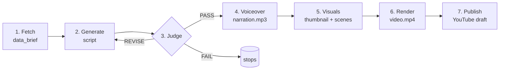

# Content Foundry — Complete Tutorial

An end-to-end guide to running the automated content pipeline: what every stage does, how to run
it, where to find your files, and how to handle every scenario (failures, resumes, cost control,
publishing).

---

## 1. What it is

Content Foundry turns **any topic** (backed by live web research, your own `--data` / `--instructions`,
and optional labor-market feeds) into a **finished, upload-ready YouTube video or vertical Short**
through 7 automated stages. Every stage writes a versioned artifact to disk, so a run is fully
**resumable** — if something fails at stage 5, you fix it and continue from stage 5; nothing earlier
is redone.

It is **grounded** (every stat traces to fetched or creator-supplied data, with verified sources
collected automatically at the bottom of the YouTube description), **quality-gated** (both an
automated 10-dimension script Judge and a pre-render `StoryboardCritic`), and **compliance-safe**
(synthetic-content disclosure is enforced; nothing auto-publishes public without it).

---

## 2. The pipeline (stages & flow)



| # | Stage name | What it does | Writes | Uses money? |
|---|-----------|--------------|--------|-------------|
| 1 | **fetch** | Pulls web-search signals (relevance-ranked multi-query fan-out) + optional job/layoff/news/BLS feeds; deterministically distills grounded `KeyFact`s (no LLM) | `data_brief.json` | data-source keys (free default) |
| 2 | **generate** | Decomposes `--instructions` (Agent 1.4), synthesizes source-backed depth (Agent 1.5, filtering `LOW_TIER_SOURCE_DOMAINS`), resolves affiliate candidates, grounds `--data` + `--instructions` figures, and writes the script + ~60% Comment Friction beat + optional `sfx` cues | `script.json`, `ideas.json`, `research.json`, `instruction_plan.json` | LLM (**free** Gemini tier or local Ollama) |
| 3 | **judge** | Scores 10 dimensions + hard gates (grounding, completeness, duplicate scenes, open-loop payoff, bio recital, creator-figure fidelity); PASS / REVISE (edits best draft in place) / FAIL | `judge_report.json` | LLM (hybrid) or **free** deterministic |
| 4 | **voiceover** | Pronunciation classification (Agent 4.5) + sentence/year/compound-safe TTS + padded micro-fade silence trimming + per-scene saved clips (`--scene` selective re-voicing) | `voiceover.json`, `assets/narration.mp3`, `assets/voiceover/`, `assets/pronunciations.json` | TTS (or **free** Edge / Piper / local Chatterbox / IndexTTS-2 clone) |
| 5 | **visuals** | Thumbnail (Agent 5.6 + surgical refine turns) + **3-tier Visual Router**: (1) 7 animated 1080p dark-mode HTML/CSS/SVG templates via Playwright → FFmpeg, (2) strict cliché-filtered stock B-roll, (3) dual-channel anti-collapse AI stills audited by `StoryboardCritic` *before* paid image calls | `visuals.json`, `shot_prompts.json`, `assets/thumbnail.png`, `assets/thumbnail_prompt.txt`, `assets/scenes/`, `assets/captions.srt` | image API (`GOOGLE_IMAGE_API_KEY`) or **free** B-roll + Playwright motion graphics |
| 6 | **render** | Studio audio mix (`mix_studio_audio`: scene SFX + `-14 dB` UI transition cues + `-30 dB` dark ambient bed → lossless WAV) + camera motion on stills + `4%` B-roll reframe + Like/Subscribe badges + `-14 LUFS` `48 kHz`/`192k` AAC encode | `video.json`, `assets/narration_mixed.wav`, `assets/citations.srt`, `assets/video.mp4` | free (local FFmpeg / GPU NVENC) |
| 7 | **publish** | Uploads Private/Unlisted draft, optimizes title/chapters/hashtags, appends deduplicated `Sources:` at the very end, sets upload-safe thumbnail with backoff, and posts "watch next" + affiliate top comment *after* privacy transition | `publish_result.json`, `end_screen.json`, `package.md` | free |

Generate ⇄ Judge is a **loop**: a REVISE verdict feeds the Judge's critique back into a rewrite, up
to `MAX_REVISIONS` times. A PASS proceeds to production; exhausting the attempts is a FAIL.

**Run states** progress: `CREATED → FETCHED → GENERATED → JUDGED → APPROVED → VOICED → VISUALIZED →
RENDERED → PUBLISHED` (plus `REVISING` during the loop and `FAILED`).

---

## 3. Quick start (100% free, offline)

**Prerequisites** (one time):
- Python 3.11+, and ffmpeg (`winget install Gyan.FFmpeg.Essentials` — then **fully restart your editor**).
- Install the CLI: `pip install content-foundry` (from PyPI), or from source for development
  (`pip install -r requirements.txt && pip install -e .`).
- Install headless Chromium once for animated 1080p motion graphics: `playwright install chromium`.
- Either a free [Google AI Studio](https://aistudio.google.com/apikey) key (`PRIMARY_PROVIDER=google`) or [Ollama](https://ollama.com) for a free offline LLM (`ollama pull qwen2.5:7b-instruct`).
- `pip install edge-tts` (free voice; already a dependency).

**.env** (copy from `.env.example`, then set):
```ini
PRIMARY_PROVIDER=local
FALLBACK_PROVIDER=none
LOCAL_LLM_BASE_URL=http://localhost:11434/v1
LOCAL_LLM_MODEL=qwen2.5:7b-instruct
TTS_PROVIDER=edge
TTS_VOICE_ID=en-US-AriaNeural
IMAGE_PROVIDER=none
ENABLED_SOURCES=search               # keyless, works on ANY niche (DuckDuckGo). Career feeds: adzuna,layoffs,bls
LAYOFFS_FEED_URL=https://layoffs.fyi/feed/
NOTIFY_ENABLED=false
```

**Validate + first run:**
```powershell
content-foundry config check                          # confirms keys/config (redacted)
content-foundry run --niche "tech careers" --dry-run  # full pipeline, no upload
```
The `--dry-run` still produces a real `assets/video.mp4` — it just skips the YouTube upload.

---

## 4. Your first run — reading the output

```
▶ content-foundry  niche tech careers  ·  fetch → publish
  ✓ Data brief  — 8 facts · search
  ⚖ attempt 1 → PASS  score 4.05/5 · insight 4.0
  ✓ Voiceover (TTS)
  ✓ Visuals & thumbnail
  ✓ Rendering video
  ✓ Publishing

run_id 0006   state PUBLISHED   verdict PASS
  data_brief   output\runs\0006\data_brief.json
  script       output\runs\0006\script.json
  ...
```

- **The `run_id`** (e.g. `0006`) is a short, sequential number printed on the last lines — you use
  it to resume, inspect, or publish that run later. It's just the next number after the highest run
  folder under `output\runs\`, so it's easy to type (`--run-id 0006`). It's also the **folder name**.
- Each `⚖ attempt` line shows the Judge verdict + score, so you see exactly why a script passed or
  needed revision.

---

## 5. Where everything lives

Every run gets its own folder:
```
outprun_meta.json           # persisted content_format, idea, --instructions, and --data
├── data_brief.json         # stage 1 — the grounded facts
├── ideas.json              # brainstormed + outlier-mined ideas & chosen pick
├── instruction_plan.json   # Agent 1.4 — decomposed atomic asks & routed plan (when --instructions used)
├── research.json           # Agent 1.5 — source-backed depth report (mechanisms) for the idea
├── script.json             # stage 2 — the script (edit this to hand-tune)
├── judge_report.json       # stage 3 — scores + the critique
├── voiceover.json          # stage 4 — timings + per-scene audio hashes
├── visuals.json            # stage 5 — routed shots, template_props & visual_meta
├── shot_prompts.json       # generated shot prompts/specs (for manual inspection or replacement)
├── video.json              # stage 6 — final video metadata
├── publish_result.json     # stage 7 — YouTube video ID, privacy & disclosure state
├── end_screen.json         # recommended prior channel uploads for Studio end-cards
├── package.md              # human summary + description (with Sources:) + disclosure checklist
├── run.log                 # structured JSON lines log for the entire run
└── assets/
    ├── narration.mp3
    ├── narration_mixed.wav # lossless PCM studio mix (narration + SFX + dark ambient bed)
    ├── voiceover/          # per-scene raw TTS clips for selective `voiceover --scene N`
    ├── pronunciations.json # Agent 4.5 acronym verdicts (version-stamped by RULES_VERSION)
    ├── thumbnail.png
    ├── thumbnail_prompt.txt# editable thumbnail prompt (reused unless `--reset`)
    ├── captions.srt
    ├── citations.srt       # top-strip burned citations (for non-graphic stat beats)
    ├── scenes/             # per-beat .mp4 (Playwright motion graphics / B-roll) and .png (AI stills)
    └── video.mp4           # ← the finished 1080p per scene
    └── video.mp4          # ← the finished video
```

**Finding a run_id later:**
```powershell
content-foundry list                 # recent runs: run_id, state, verdict, created_at
content-foundry list --state FAILED  # filter by state
```stops at `render` by default; pass `--publish` to upload) |
| `fetch` | Stage 1 only → `data_brief.json` |
| `generate --input data_brief.json` | Stage 2 only (accepts `--instructions` and `--data`) |
| `judge --input script.json` | Stage 3 only |
| `voiceover --run-id <id> [--scene N]` | Stage 4 (pass repeatable `--scene N` to re-voice only edited scenes) |
| `visuals --run-id <id> [--force-images] [--free-images]` | Stage 5 (keeps existing AI `.png`s & rendered `.mp4` graphics unless `--force-images`) |
| `shots --run-id <id>` | Regenerate ONLY the AI-generated `.png` shots in place, leaving B-roll clips & thumbnail untouched |
| `thumbnail --run-id <id> [--prompt "..."] [--reset]` | Regenerate ONLY the thumbnail; reuses `assets/thumbnail_prompt.txt` unless `--reset` or `--prompt` |
| `render --run-id <id> [--backend ffmpeg]` | Stage 6 (reassembles edited scene clips automatically) |
| `publish --run-id <id> [--dry-run] [--privacy private] [--mode draft]` | Stage 7 |
| `resume --run-id <id> [--to-stage publish]` | **Continue a run from its next stage automatically** |
| `status --run-id <id>` | State, verdict, and a table of attempts/scores |
| `list [--limit 20] [--state FAILED]` | Recent runs |
| `report --run-id <id>` | Pretty-print the Judge report (per-dimension scores) |
| `dashboard [--port 8501]` | Launch the Streamlit review UI |
| `init-db` | Create the database tables (auto-run anyway) |
| `config check [--profile cheap]` | Validate `.env`; redacted credential table |
| `notify-test` | Send a sample of each alert to verify your bot |
| `schedule [--cron "0 9 * * MON"]` | Run on a schedule |

Key `run` options: `--niche`, `--topic`, `--idea`, `--instructions`, `--data`, `--brainstorm/--no-brainstorm`,
`--template`, `--format` (long\|short), `--from-stage`, `--to-stage`, `--publish`, `--run-id`, `--input`,
`--force`, `--dry-run`. By default `--idea` is used **verbatim**; add `--brainstorm` to explore angles
(+ proven YouTube outliers when `IDEA_MINING_ENABLED=true`) around it. `--instructions` steers both
research queries and script structure while preserving any numbers you state; `--data` (literal lines or
a `.txt` file) injects highest-priority citable facts. `--format short` produces a **vertical 9:16
YouTube Short** (~35–50s, big burned captions), persisted in `run_meta.json` across re-runs.

---

## 7. Understanding the Judge

The Judge scores 10 dimensions (0–5). Five have **hard floors** — miss a floor and it's a REVISE
no matter the total:

| Dimension | Weight | Floor | How scored |
|---|---|---|---|
| Actionability | 14% | — | LLM (hybrid) |
| Specificity | 14% | — | deterministic |
| Factual Grounding | 14% | **`GROUNDING_MIN` (4.0)** | deterministic |
| Insight | 14% | **`INSIGHT_MIN` (3.5)** | LLM (hybrid) |
| Engagement | 10% | **`ENGAGEMENT_MIN` (2.5)** | LLM (hybrid) |
| Wittiness | 7% | **`WITTINESS_MIN` (2.5)** | LLM (hybrid) |
| Ending / Sign-off | 7% | **`ENDING_MIN` (3.0)** | deterministic |
| Hook & Retention | 10% | — | deterministic |
| Structural Freshness | 7% | — | deterministic |
| Compliance | 3% | pass/fail | deterministic |

- **PASS**: weighted total ≥ `PASS_THRESHOLD` (3.75 default; 3.9 in `.env.example`) **and** all floors + deterministic hard gates met.
- **Hard deterministic gates (zero tokens):** completeness (`MIN_SCENES` + `MIN_SCRIPT_WORD_RATIO`), duplicate-scene 3-gram Jaccard (`MAX_SCENE_SIMILARITY`), promised open-loop delivery (`open_loop_report`), anti-verbatim bio recital (`credential_recital_report`), and creator-figure fidelity (`specified_figures_report` — rejects any draft that alters a figure from `--instructions`).
- **REVISE**: edits the **best-scoring draft so far** in place (never starting over from scratch), up to `MAX_REVISIONS`.
- **FAIL**: never passed within `MAX_REVISIONS` (usually a *data* problem, not writing).

**Completeness gate (hard).** Independent of the score, a script is REVISEd if it's too short — fewer
than `MIN_SCENES` (3) scenes **or** below `MIN_SCRIPT_WORD_RATIO × SCRIPT_TARGET_WORDS` words (default
`0.5 × 900 = 450`). Every grounded statistic with a verified external source carries its source on
screen (either inside an animated motion-graphic `SOURCE //` pill or top-strip `citations.srt`) and is
collected into a deduplicated `Sources:` section at the very bottom of the YouTube description.

**Gate relief.** A draft scoring ≥ `GATE_RELIEF_SCORE` (4.5 on the 0–5 scale) earns `GATE_RELIEF_RATIO`
(20%) slack on the **insight**, **wittiness**, **engagement**, and **length** floors — so a near-miss
doesn't block an otherwise-excellent script. Grounding, compliance, ending not writing).

**Completeness gate (hard).** Independent of the score, a script is REVISEd if it's too short — fewer
than `MIN_SCENES` (3) scenes **or** below `MIN_SCRIPT_WORD_RATIO × SCRIPT_TARGET_WORDS` words (default
`0.5 × 900 = 450`). This is why a script can score **4+/5 and still not PASS**: high quality but too
short — `report` shows a `LENGTH:` line when it fires. If your local model under-produces, lower
`SCRIPT_TARGET_WORDS` (e.g. `350`) or use a bigger model. Every statistic also carries its **source**
on screen (`… · Source: Adzuna`), enforced in code so a stat can never appear un-sourced.

**Gate relief.** A draft scoring ≥ `GATE_RELIEF_SCORE` (9.0) earns `GATE_RELIEF_RATIO` (20%) slack on
the **insight** and **length** floors — so a near-miss doesn't block an otherwise-excellent script
(the report `summary` says when relief was applied). Grounding, compliance, and anti-repetition are
**never** relaxed.

Inspect it: `content-foundry report --run-id <id>` shows every dimension's score + the reasoning.

`JUDGE_MODE`: `hybrid` (default, 1 small LLM call), `deterministic` (0 LLM, heuristics only — free
& fast), or `llm` (all dims by LLM).

---

## 8. Resuming & partial runs (the important part)

Because every stage persists an artifact, you can start/stop anywhere. Two mechanisms:

**A) `resume` — automatic.** It looks up the run's state and continues from the *next* stage:
```powershell
content-foundry resume --run-id <id>                 # e.g. JUDGED → voiceover onward
content-foundry resume --run-id <id> --to-stage render
```
If the run **FAILED**, resume figures out the right restart point from the artifacts on disk — a
script that failed judging retries from **generate**, a render that died resumes from **render** —
so it never needlessly re-fetches.

**B) `run --from-stage / --to-stage` — explicit.** Full control:
```powershell
# Re-do generation+judge (e.g. after switching the model), then stop at judge:
content-foundry run --run-id <id> --from-stage generate --to-stage judge --dry-run

# Continue from voiceover to the end (after a PASS):
content-foundry run --run-id <id> --from-stage voiceover --dry-run
```

**Reuse is automatic:** if an artifact for a stage already exists, it's reused (no re-paying for
TTS/images). Add `--force` to regenerate it anyway.

**Hand-editing:** stop after judge, open `script.json`, edit the narration, then resume from
voiceover — the edit is detected and provenance is stamped `operator_edited`:
```powershell
content-foundry run --run-id <id> --from-stage voiceover --dry-run
```

---

## 9. Configuration (.env groups)

### Editing narration without redoing every scene

New voiceovers keep the exact provider-produced audio for each scene under
`assets/voiceover/`. The `scene_audio` entries in `voiceover.json` record their paths,
original text, hashes, and relative word timings. Use the scene's `index` from `script.json`
(normally zero-based), not its position in a displayed list:

```powershell
content-foundry voiceover --run-id <id> --scene 3
content-foundry voiceover --run-id <id> --scene 3 --scene 7
content-foundry render --run-id <id>
```

After correcting narration in `script.json`, select every changed scene. Unselected scenes
reuse their original bytes. Changed voice settings, pronunciation in unselected scenes,
missing clips, and mismatched scene layouts stop selective regeneration rather than
silently regenerating other material. Ordinary `voiceover --run-id <id>` still regenerates
all scenes. Old runs without saved scene clips still render normally; they need one full
voiceover before selective regeneration becomes available.

For an external audio correction, back up and replace the scene file named by its `scene_audio`
entry, then run `render`. The replacement must contain the same narration and already have
the desired pause/silence treatment. Rendering measures the new audio, rebuilds the joined
track and timings, refreshes captions, and uses the existing visuals. It does not call TTS
or generate images. Invalid audio leaves the previous joined narration intact. Replacement
word timings are estimated across the measured scene duration, not forced-aligned; review
captions after a manual replacement.

The editable boundary is a **whole scene**, preserving the provider's existing sentence
splitting and prosody. Silence compression and punctuation pauses still happen inside the
TTS provider, exactly once. Joining uses the same opening/SFX gaps and codec path as before;
loudness and speed processing remain in the renderer. A joined preview is still created
during voiceover because the visuals stage needs its timing backbone. Render only rebuilds
it when saved audio or assembly settings change, or the preview is missing.

### Wit craft

`SCRIPT_WIT_CRAFT_ENABLED=true` is the default. It adds topic-specific observational humor,
economical setups, and earned ca**google**\|anthropic\|openai\|**local**), `FALLBACK_PROVIDER`, `GOOGLE_API_KEY`, `GOOGLE_MODELS`, `GOOGLE_THINKING`, `LOCAL_LLM_BASE_URL`, `LOCAL_LLM_MODEL`, `GENERATOR_MODEL`, `JUDGE_MODEL` |
| **Data** | `ENABLED_SOURCES` (**search**\|adzuna\|layoffs\|news\|bls), `LOW_TIER_SOURCE_DOMAINS`, `ADZUNA_APP_ID/KEY`, `NEWSAPI_KEY`, `LAYOFFS_FEED_URL` |
| **Web search** | `SEARCH_PROVIDER` (**duckduckgo** no-key\|tavily\|brave — auto-chains fallbacks), `TAVILY_API_KEY`, `BRAVE_API_KEY`, `SEARCH_MAX_RESULTS`, `SEARCH_QUERY_COUNT`, `SEARCH_FACETS` |
| **Research & Planner** | `INSTRUCTION_PLANNER_ENABLED`, `RESEARCH_ENABLED`, `RESEARCH_MAX_SOURCES`, `RESEARCH_MAX_POINTS`, `RESEARCH_MAX_CHARS_PER_SOURCE`, `RESEARCH_FETCH_TIMEOUT_SEC` |
| **Pipeline** | `MAX_REVISIONS`, `JUDGE_MODE`, `PASS_THRESHOLD`, `INSIGHT_MIN`, `ENGAGEMENT_MIN`, `WITTINESS_MIN`, `ENDING_MIN`, `GROUNDING_MIN`, `MIN_FACTS`, `MAX_FACTS`, `MIN_SCENES`, `MIN_SCRIPT_WORD_RATIO`, `GATE_RELIEF_SCORE`, `GATE_RELIEF_RATIO`, `BRAINSTORM_ENABLED`, `TARGET_NICHE`, `SCRIPT_TARGET_WORDS`, `FAIL_FAST_SCORE` |
| **Voice** | `TTS_PROVIDER` (elevenlabs\|openai\|**edge**\|**piper**\|**chatterbox**\|**indextts**), `TTS_REFERENCE_CLIP`, `TTS_TONE`, `TTS_EDGE_PAD_MS` (`55`), `TTS_TAIL_PAD_MS` (`85`), `TTS_MICRO_FADE_MS` (`15`), `TTS_SENTENCE_PAUSE_MS`, `PRONUNCIATION_LLM_ENABLED`, `INDEXTTS_*` (separate venv), `VOICEOVER_LEAD_IN_SEC`, `SFX_GAP_SEC` |
| **Visuals & Images** | `IMAGE_PROVIDER` (google\|openai\|stability\|pollinations\|**none**), `GOOGLE_IMAGE_API_KEY` (isolated paid key), `GOOGLE_IMAGE_MODELS`, `GOOGLE_IMAGE_USE_PAID_KEY`, `PEXELS_API_KEY`, `PIXABAY_API_KEY`, `BROLL_RELEVANCE_THRESHOLD`, `BROLL_STYLE_BANLIST`, `VISUALS_REDO_IMAGES`, `THUMBNAIL_DIRECTOR_ENABLED`, `THUMBNAIL_REFINE_TURNS` |
| **Motion Graphics & Critic** | `ENABLE_PROGRAMMATIC_GRAPHICS`, `ENABLE_STORYBOARD_CRITIC`, `ENABLE_COMMENT_FRICTION_BEAT`, `TARGET_PROGRAMMATIC_RATIO` (`MIN_`/`MAX_`), `SILENT_PREVIEW_WINDOW_SEC`, `OPENING_PEAK_WINDOW_SEC`, `PROGRAMMATIC_ANCHOR_MIN_SEC`/`MAX_SEC`, `MAX_TEMPLATE_DURATION_SEC` (`8.0`), `TPL_<ID>_{ENABLED,WEIGHT,MAX_CHARS}` (all 7 templates), `MAX_SETTING_ARCHETYPE_REPEATS` (`2`), `MIN_HUMAN_PRESENCE_RATIO` (`0.35`), `CLICHE_BANLIST`, `IMAGE_STYLE_BIBLE`, `CRITIC_MAX_RETRIES` |
| **Render & Polish** | `RENDER_BACKEND`, `FFMPEG_PATH`, `VIDEO_ENCODER` (`auto` NVENC/QSV/AMF → libx264), `VIDEO_RESOLUTION`, `VIDEO_SPEED` (`1.04`), `AUDIO_LOUDNESS_LUFS` (`-14`), `IMAGE_MOTION`, `SCENE_TRANSITION`, `COLOR_WARMTH`, `SUBSCRIBE_NUDGE_ENABLED`, `LIKE_NUDGE_ENABLED`, `AVATAR_OVERLAY_ENABLED` |
| **Studio Audio & SFX** | `SFX_ENABLED`, `SFX_DIR`, `FREESOUND_API_KEY`, `SFX_VOLUME_DB`, `PROGRAMMATIC_SFX_ENABLED`, `PROGRAMMATIC_SFX_VOLUME_DB` (`-14`), `ENABLE_AMBIENT_MUSIC`, `AMBIENT_MUSIC_VOLUME_DB` (`-30`), `AMBIENT_MUSIC_PATH` |
| **Publish & Affiliates** | `PUBLISH_MODE`, `YOUTUBE_PRIVACY_STATUS`, `REQUIRE_MANUAL_DISCLOSURE_BEFORE_PUBLIC`, `RECOMMEND_COMMENT_ENABLED`, `END_SCREEN_ENABLED`, `AFFILIATE_ENABLED`, `AFFILIATE_CURATED_CATALOG`, `AMAZON_ASSOC_TAG`, `AFFILIATE_{EXPONENT,EDUCATIVE,DESIGNGURUS,FENZO}_*
| **LLM** | `PRIMARY_PROVIDER` (anthropic\|openai\|**local**), `FALLBACK_PROVIDER`, `LOCAL_LLM_BASE_URL`, `LOCAL_LLM_MODEL`, `GENERATOR_MODEL`, `JUDGE_MODEL` |
| **Data** | `ENABLED_SOURCES` (adzuna\|layoffs\|news\|bls\|**search**), `ADZUNA_APP_ID/KEY`, `NEWSAPI_KEY`, `LAYOFFS_FEED_URL` |
| **Web search** | `SEARCH_PROVIDER` (**duckduckgo** no-key\|tavily\|brave), `TAVILY_API_KEY`, `BRAVE_API_KEY`, `SEARCH_MAX_RESULTS`, `SEARCH_QUERY_COUNT`, `SEARCH_FACETS` (multi-query fan-out) |
| **Research (Agent 1.5)** | `RESEARCH_ENABLED`, `RESEARCH_MAX_SOURCES`, `RESEARCH_MAX_POINTS`, `RESEARCH_MAX_CHARS_PER_SOURCE`, `RESEARCH_FETCH_TIMEOUT_SEC` |
| **Pipeline** | `MAX_REVISIONS`, `JUDGE_MODE`, `PASS_THRESHOLD`, `INSIGHT_MIN`, `GROUNDING_MIN`, `MIN_FACTS`, `MAX_FACTS`, `MIN_SCENES`, `MIN_SCRIPT_WORD_RATIO`, `GATE_RELIEF_SCORE`, `GATE_RELIEF_RATIO`, `BRAINSTORM_ENABLED`, `BRAINSTORM_IDEA_COUNT`, `REQUIRE_SCRIPT_APPROVAL`, `TARGET_NICHE`, `SCRIPT_TARGET_WORDS`, `FAIL_FAST_SCORE` |
| **Voice** | `TTS_PROVIDER` (elevenlabs\|openai\|**edge**\|**piper**\|**chatterbox**\|**indextts** — the last two clone your own voice for free), `TTS_VOICE_ID`, `TTS_VOICE_MALE`/`TTS_VOICE_FEMALE` (alternate narrator by run-id parity), `PIPER_MODEL_PATH`, `TTS_REFERENCE_CLIP`/`TTS_CLONE_DEVICE` (clone), `TTS_TONE` (match the cloned delivery to the script), `TTS_EDGE_PAD_MS`/`TTS_SENTENCE_PAUSE_MS` (punctuation-aware pauses), `INDEXTTS_*` (IndexTTS-2 runs in its own venv) |
| **Visuals** | `IMAGE_PROVIDER` (openai\|stability\|google\|pollinations\|**none**), `PEXELS_API_KEY`, `PIXABAY_API_KEY` (2nd free B-roll source), `SCENES_PER_VIDEO`, `DIAGRAMS_ENABLED` (draw matrices/bars/ladders/pipelines instead of generating them), `VISUALS_REDO_IMAGES`, `GOOGLE_IMAGE_USE_PAID_KEY`, `THUMBNAIL_DIRECTOR_ENABLED`, `THUMBNAIL_REFINE_TURNS` (surgical touch-up passes over the thumbnail prompt; 0 = off) |
| **Render** | `RENDER_BACKEND`, `FFMPEG_PATH` (blank = auto-discover), `VIDEO_RESOLUTION`, `VIDEO_SPEED`, `AVATAR_OVERLAY_ENABLED`, `AUDIO_LOUDNESS_LUFS` (master the final mix so the upload isn't quiet), `IMAGE_MOTION` (slow camera move on stills) |
| **Content format** | `CONTENT_FORMAT` (long\|**short** vertical Short), `SHORTS_RESOLUTION`, `SHORTS_TARGET_WORDS`, `SHORTS_SCENES`, `SHORTS_BURN_CAPTIONS`, `SHORTS_SCENE_TRANSITION`, `SHORTS_HASHTAG` |
| **Scene polish** | `SCENE_TRANSITION` (fade/dissolve/…), `SCENE_TRANSITION_SEC`, `COLOR_WARMTH` (warm grade), `SUBSCRIBE_NUDGE_ENABLED` |
| **Sound FX** | `SFX_ENABLED`, `SFX_DIR` (local clip library), `FREESOUND_API_KEY` (optional), `SFX_VOLUME_DB` |
| **Publish** | `PUBLISH_MODE` (draft\|auto), `YOUTUBE_PRIVACY_STATUS`, `REQUIRE_MANUAL_DISCLOSURE_BEFORE_PUBLIC` |
| **Budget** | `MONTHLY_BUDGET_USD`, `ENFORCE_BUDGET_CAP` (hard stop when over budget) |

> ⚠️ In `.env`, don't put a trailing `# comment` on a **blank** value line (e.g. `MODEL_HEAVY= # …`)
> — the comment becomes the value. Put the comment on the line above.

---

## 10. Cost control

Cheapest → most expensive:
1. **Local LLM** — `PRIMARY_PROVIDER=local` (Ollama). Generation is free.
2. **Free voice** — `TTS_PROVIDER=edge` (online, no key) or `piper` (offline), or `chatterbox` to clone your own voice (local, GPU-accelerated). *(TTS is the biggest paid cost.)*
3. **Free visuals** — `IMAGE_PROVIDER=none` (polished cards) + a free Pexels key for real B-roll.
4. **`--profile cheap`** — deterministic judge + cards + a single revision, in one flag.
5. **Budget cap** — `ENFORCE_BUDGET_CAP=true` aborts a run once estimated month-to-date spend hits
   `MONTHLY_BUDGET_USD`.

Rough per-video cost: **~$0** fully local, **~$0.10** with cloud TTS, **~$2** on all paid defaults.

---

## 11. Publishing to YouTube

- **Always test first with `--dry-run`** — produces the full video locally, no upload.
- For real uploads you need the one-time Google OAuth setup (see `Human_Tasks.md` §4:
  create a Google Cloud project → enable YouTube Data API v3 → OAuth desktop credentials →
  `secrets/client_secrets.json`).
- **Safety by default:** videos upload **Private** as a draft (`PUBLISH_MODE=draft`). A video can
  **never** go public while `REQUIRE_MANUAL_DISCLOSURE_BEFORE_PUBLIC=true` and you haven't ticked
  "Altered or synthetic content" in YouTube Studio. See `package.md`'s disclosure checklist.
- Real publish: `content-foundry publish --run-id <id>` (no `--dry-run`); first run opens a browser
  consent once and caches `secrets/youtube_token.json`.

---

## 12. The dashboard

```powershell
content-foundry dashboard        # opens http://localhost:8501
```
A read-mostly Streamlit UI to spot-check the Judge report, watch for generic-content drift, and
approve drafts — the thin human layer. You're never in the writing loop.

---

## 13. Troubleshooting & scenarios

| Situation | What to do |
|---|---|
| **"ffmpeg not found"** | It auto-discovers now; if it still can't find it, set `FFMPEG_PATH=` to your `ffmpeg.exe`, or **fully restart your editor** so the PATH refreshes (reopening a terminal isn't enough). |
| **`ollama`/`ffmpeg` missing after reopening a terminal** | VS Code caches its environment at launch. **Quit and reopen VS Code entirely** (or reboot). The app talks to Ollama over HTTP, so it doesn't need the `ollama` CLI on PATH — only ffmpeg matters for rendering. |
| **Run ends `FAILED` / verdict `FAIL`** | The script never cleared the Judge's floors in `MAX_REVISIONS` tries. Run `content-foundry report --run-id <id>` and read `revision_instructions` — the failing gate is named there. Usually **length** (too short), **insight**, or **grounding**. |
| **Scored high (8+) but still `FAILED`** | The **completeness gate**: the script is too short (< `MIN_SCENES` scenes or < `MIN_SCRIPT_WORD_RATIO`×`SCRIPT_TARGET_WORDS` words). `report` shows a `LENGTH:` note. Lower `SCRIPT_TARGET_WORDS` (e.g. `350` for a 7B local model) or use a bigger model like `qwen2.5:14b`. |
| **Score too low / insight floor** | UsRevisions edit the **best-scoring attempt so far** in place (`KEEP INTACT` + targeted fix-list) rather than starting from scratch; if a small local model still oscillates, switch to a stronger model (`gemini-2.5-flash` or `qwen2.5:14b`). |
| **"insufficient facts" / no data** | A data source returned too little. Add real Adzuna keys, verify `LAYOFFS_FEED_URL` (try `https://layoffs.fyi/feed/`), or enable `bls` (keyless). Need ≥ `MIN_FACTS` (3). |
| **Any niche / the feeds don't fit your topic** | Add `search` to `ENABLED_SOURCES` (e.g. `ENABLED_SOURCES=search` for search-only, or `adzuna,search`). It runs a web search on your run's topic (`--niche` + `--idea`), so it works for **any** subject — not just jobs/layoffs. Free via DuckDuckGo (no key); set `SEARCH_PROVIDER=tavily` or `brave` with a free key for a stronger index. |
| **A data source failed** | Runs degrade gracefully — the `✓ Data brief` line shows which sources succeeded. As long as ≥3 facts come back, it proceeds. |
| **Want to resume after a crash** | `content-foundry resume --run-id <id>` — it continues from the next stage; completed stages are reused. |
| **Change the model and retry** | Edit `LOCAL_LLM_MODEL`, then `content-foundry run --run-id <id> --from-stage generate --dry-run`. |
| **Want a real video but no upload** | `--dry-run`. The mp4 is at `output\runs\<id>\assets\video.mp4`. |
| **Want better visuals** | Keep `ENABLE_PROGRAMMATIC_GRAPHICS=true` (7 animated 1080p dark-mode templates via Playwright), add free `PEXELS_API_KEY` + `PIXABAY_API_KEY` for strict B-roll, and optionally set `IMAGE_PROVIDER=google` with an isolated `GOOGLE_IMAGE_API_KEY` for bespoke editorial AI stills. |
| **Repetitive / off-topic B-roll** | Add `PIXABAY_API_KEY` alongside Pexels, raise `BROLL_RELEVANCE_THRESHOLD` (e.g. `0.82`), or extend `BROLL_STYLE_BANLIST`. Clips are filtered against both the cliché/style blacklist and spoken-moment overlap, **used at most once each**, and picked deterministically (top-ranked match; misses fall back to dual-channel AI stills or motion graphics)
| **Repetitive / off-topic B-roll** | Add a free `PIXABAY_API_KEY` alongside Pexels so each scene draws from a bigger, mixed pool. Clips are pulled per keyword (per scene), **used at most once each** (never repeated anywhere — a hole is filled with a different fresh clip), and are seeded by the run id so different runs pick different clips. The LLM B-roll director (`BROLL_DIRECTOR_ENABLED`) rewrites each scene's queries to be literal and globally distinct. |
| **Want sound effects** | Set `SFX_ENABLED=true`. The script author writes short `sfx` cues (whoosh, ding, cash register…) into scenes and the renderer mixes the matching clip from `data/sounds` in at each cue's moment. Add more clips to that folder or set `FREESOUND_API_KEY` to auto-download missing ones; tune loudness with `SFX_VOLUME_DB`. |
| **Smoother look / branding** | `SCENE_TRANSITION=fade` crossfades between scenes (`fadewhite` = a light flash); `COLOR_WARMTH=0.25` warms the whole grade; `SUBSCRIBE_NUDGE_ENABLED=true` pops a small Subscribe badge at the midpoint. All three are render-only — apply them to an existing run with `content-foundry run --run-id <id> --from-stage render`. |
| **Captions out of sync / want subtitles** | Burned-in narration captions are **off by default** — YouTube auto-generates synced closed captions for free once your draft finishes processing. A burned track only stays in sync with a **timing-capable voice** (`elevenlabs`/`edge`); `chatterbox`/`piper` even-split and drift. Set `CAPTIONS_ENABLED=true` only with those voices. Source citations always show regardless. |
| **Telegram 404 / notification error** | Harmless with placeholder tokens. Set `NOTIFY_ENABLED=false`, or add a real bot token (`Human_Tasks.md` §5). |
| **Config won't load** | `content-foundry config check` prints the exact validation error. |
| **Budget hit** | `ENFORCE_BUDGET_CAP=true` stopped the run. Raise `MONTHLY_BUDGET_USD` or set it false. |
| **Duplicate/odd results** | Signals are cached for `SIGNAL_CACHE_TTL_MIN` (12h). Wait or lower the TTL to force a refetch. |

---

## 14. Glossary

- **Artifact** — the versioned JSON (+ media) each stage writes; the unit of resumability.
- **run_id** — the short sequential number (e.g. `0006`) identifying a run; also its folder name under `output\runs\`.
- **Brief** — `data_brief.json`; the grounded facts the script must cite.
- **Verdict** — the Judge's decision: PASS / REVISE / FAIL.
- **Floor** — a minimum score a dimension must hit (grounding, insight) regardless of the total.
- **Production gate** — the check that only a PASS (or `--force`) may proceed to voiceover→publish.
- **Disclosure gate** — the non-negotiable rule that nothing goes public without the synthetic-content disclosure.
- **Dry run** — full pipeline including a real mp4, but no YouTube upload.
